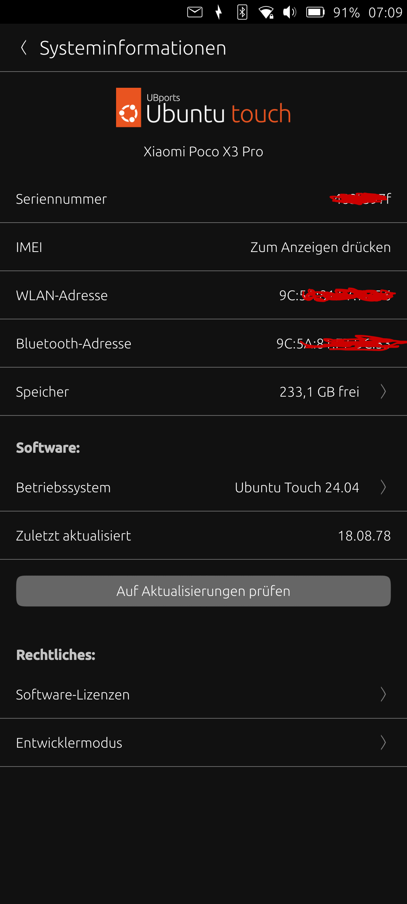
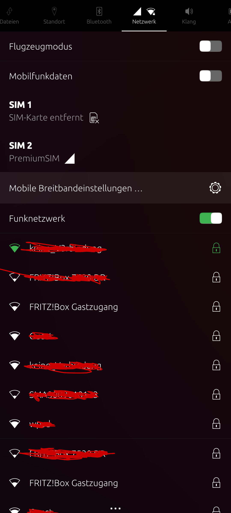
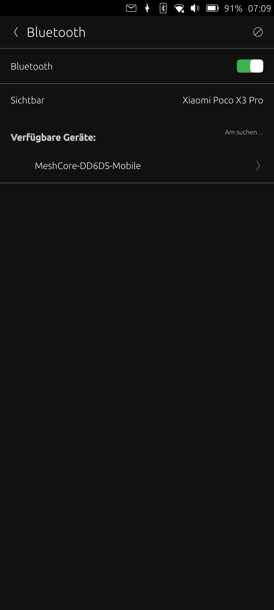
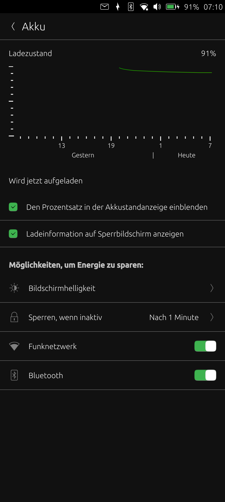
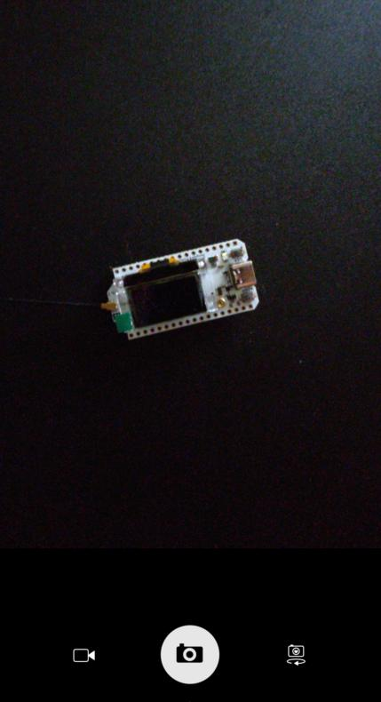
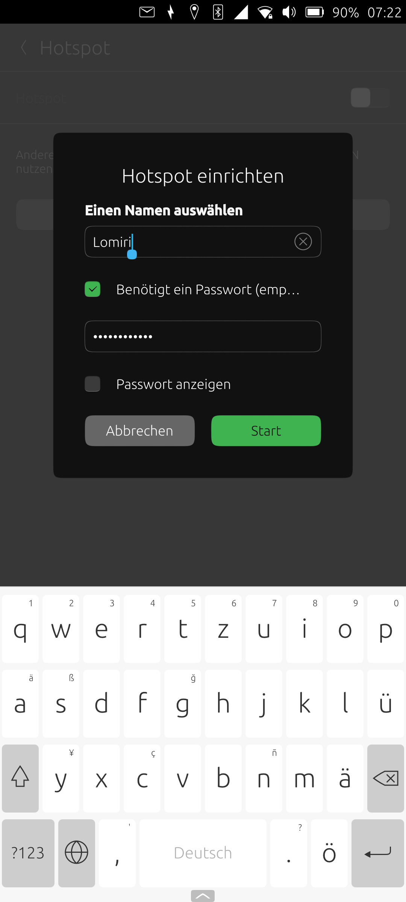
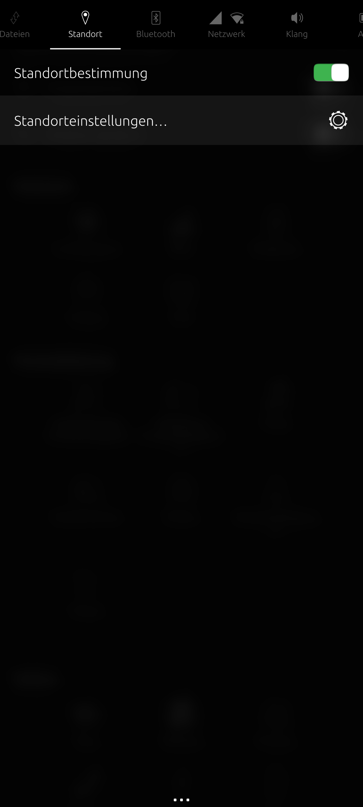

# Ubuntu Touch 24.04 für Xiaomi Poco X3 Pro (vayu) – Flash-Kit

*English version: [README.md](README.md)*

Inoffizielles Ubuntu-Touch-Image für das Poco X3 Pro (Codename **vayu**), gebaut aus:

| Teil | Quelle |
|---|---|
| Rootfs | UBports **24.04-2.2 stable** (Ubuntu 24.04.5 LTS), von system-image.ubports.com |
| Kernel / boot.img / dtbo.img / Device-Overlay | Community-Port `ubports/porting/community-ports/android11/xiaomi-poco-x3-pro/xiaomi-vayu` (CI-Build 19.10.2026) |
| Halium | Halium 11 generic arm64 (UBports Jenkins) |
| vendor.img / vbmeta.img | Droidian vayu Snapshot 18.11.2024 (MIUI-Vendor mit Linux-Fixes) |
| Recovery | OrangeFox R11.3 stable für vayu (wird nur temporär gestartet, nie installiert) |

> ⚠️ Das ist **kein** offizielles UBports-Release, das Gerät ist **nicht** im UBports-Installer.
> Das Flashen löscht **alle Daten** auf dem Telefon. Nutzung auf eigene Gefahr.

## Hardware-Unterstützung

Getestet am 28.10.2026 mit diesem Kit (UT 24.04-2.2 stable) auf einem Poco X3 Pro (Firmware-Basis MIUI 12.5.5 EEA).

| Funktion | Status |
|---|---|
| WLAN | ✅ FUNKTIONIERT |
| Bluetooth | ✅ FUNKTIONIERT |
| Kamera | ✅ FUNKTIONIERT |
| Ton / Lautsprecher | ✅ FUNKTIONIERT |
| Akku laden | ✅ FUNKTIONIERT |
| Flugmodus | ✅ FUNKTIONIERT |
| Hotspot | ✅ FUNKTIONIERT |
| GPS | ✅ FUNKTIONIERT |
| Mobilfunk / Telefonieren | ✅ FUNKTIONIERT |
| Taschenlampe | ✅ FUNKTIONIERT |
| Kamerawechsel (vorne/hinten) | ✅ FUNKTIONIERT |
| Video | ✅ FUNKTIONIERT |
| Mobile Daten | ✅ FUNKTIONIERT |
| SIM-PIN entsperren | ✅ FUNKTIONIERT |
| Lautstärke im Gespräch | ✅ FUNKTIONIERT |
| Akkustand in Prozent | ✅ FUNKTIONIERT |
| Laden im ausgeschalteten Zustand | ✅ FUNKTIONIERT |
| SD-Karte | ✅ FUNKTIONIERT |
| Ausschalten / Neustart | ✅ FUNKTIONIERT |

### Screenshots

<table>
<tr><td align="center"><br><sub>Systeminformationen</sub></td><td align="center"><br><sub>WLAN + Mobilfunk</sub></td><td align="center"><br><sub>Bluetooth (MeshCore-Node gefunden)</sub></td></tr>
<tr><td align="center"><br><sub>Akku / Laden</sub></td><td align="center"><br><sub>Kamera</sub></td><td align="center"><br><sub>Hotspot</sub></td></tr>
<tr><td align="center"><br><sub>Hotspot einrichten</sub></td><td align="center"><br><sub>Standort</sub></td><td align="center"><br><sub>Standorteinstellungen (GPS)</sub></td></tr>
</table>

<details><summary>Vollständige Feature-Matrix (Aufbau wie auf devices.ubuntu-touch.io)</summary>

✅ = funktioniert · ❔ = noch nicht getestet

| Kategorie | Funktion | Status |
|---|---|---|
| Actors | Manual brightness | ❔ |
|  | Notification LED | ❔ |
|  | Torchlight | ✅ |
|  | Vibration | ❔ |
| Camera | Flashlight | ❔ |
|  | Photo | ✅ |
|  | Switching between cameras | ✅ |
|  | Video | ✅ |
| Cellular | Change audio routings | ❔ |
|  | Incoming, outgoing calls | ✅ |
|  | Carrier info, signal strength | ✅ |
|  | Data connection | ✅ |
|  | Dual SIM functionality | ❔ |
|  | MMS in, out | ❔ |
|  | PIN unlock | ✅ |
|  | SMS in, out | ❔ |
|  | Voice in calls | ✅ |
|  | LTE calling (VoLTE) | ❔ |
|  | Volume control in calls | ✅ |
| Endurance | 24+ hours battery lifetime | ❔ |
|  | 7+ days stability | ❔ |
| GPU | Boot into UI | ✅ |
|  | Hardware video playback | ❔ |
| Misc | AppArmor patches | ❔ |
|  | Battery percentage | ✅ |
|  | Reset to factory defaults | ❔ |
|  | Offline charging | ✅ |
|  | Online charging | ✅ |
|  | Recovery image | ❔ |
|  | RTC time | ❔ |
|  | SD card storage | ✅ |
|  | Shutdown / Reboot | ✅ |
|  | Waydroid | ❔ |
|  | Wireless External monitor | ❔ |
| Network | Bluetooth | ✅ |
|  | Flight mode | ✅ |
|  | Hotspot | ✅ |
|  | NFC | ❔ |
|  | WiFi | ✅ |
| Sensors | Automatic brightness | ❔ |
|  | Double touch to wake | ❔ |
|  | Fingerprint reader | ❔ |
|  | GPS | ✅ |
|  | Proximity | ❔ |
|  | Rotation | ❔ |
|  | Touchscreen | ✅ |
| Sound | Earphones | ❔ |
|  | Loudspeaker | ✅ |
|  | Microphone | ✅ |
|  | Volume control | ✅ |
| USB | ADB access | ❔ |
|  | MTP access | ❔ |

</details>

## Inhalt

```
flash.sh                  automatisches Flash-Skript (Linux)
SHA256SUMS                Prüfsummen der Images
images/
  boot.img                UT-Kernel + Halium-Initramfs
  dtbo.img                Device-Tree-Overlay (passend zum Kernel)
  vbmeta.img              wird mit deaktivierter Verifizierung geflasht
  vendor.img              Droidian-vayu-Vendor
  orangefox-R11.3-vayu-recovery.img
  ubuntu.img              Ubuntu-Touch-24.04-Rootfs (kommt nach /data)
screenshots/              Screenshots vom Gerät
build/
  build-2404.sh           lädt + baut das komplette Kit, ohne root
  out/device_vayu_usrmerge.tar.xz
```

## Voraussetzungen

- Poco X3 Pro (vayu) mit **MIUI 12.5.x / Android 11** (Firmware-Basis für Halium 11). Getestet mit MIUI 12.5.5 EEA.
- Linux-PC mit `adb`, `fastboot` (android-tools / `android-sdk-platform-tools`), `python3`, `python3-venv`.
- Ein gutes USB-Datenkabel.
- Ca. 6 GB freier Speicherplatz.

---

## Schritt 1 – Bootloader entsperren (mit miunlock im Python-venv)

Xiaomis offizielles Mi-Unlock-Tool gibt es nur für Windows. **miunlock** ist eine Python-Nachbildung, die unter Linux läuft.

### 1.1 Xiaomi-Konto und Telefon vorbereiten

1. Am Xiaomi-Konto **muss eine Telefonnummer hinterlegt** sein, sonst meldet miunlock
   `code 20041: your MI ID is not associated with a phone number`.
   Konten, die per *Mit Google anmelden* erstellt wurden, haben oft keine Telefonnummer und kein Passwort –
   dann ein neues Xiaomi-Konto **mit Telefonnummer registrieren**.
2. Am Telefon: **Einstellungen → Über das Telefon → Alle Spezifikationen → 7× auf „MIUI-Version" tippen**
   (nicht auf „Kernel-Version" – das öffnet das CIT-Testmenü).
3. **Einstellungen → Weitere Einstellungen → Entwickleroptionen**:
   - **OEM-Entsperrung** und **USB-Debugging** einschalten
   - mit dem Xiaomi-Konto anmelden (Einstellungen → Mi-Konto)
4. **SIM-Karte** einlegen, **WLAN aus**, **mobile Daten an**, dann
   **Entwickleroptionen → Mi Unlock status → Konto und Gerät hinzufügen**. Auf „Erfolgreich hinzugefügt" warten.
   Die SIM kann danach wieder raus.

### 1.2 miunlock im venv installieren

```bash
python3 -m venv ~/poco_X3_pro
source ~/poco_X3_pro/bin/activate
pip install miunlock          # im venv KEIN --user!
```

### 1.3 Entsperren

```bash
source ~/poco_X3_pro/bin/activate
adb reboot bootloader         # oder: ausschalten, Leiser + Power halten
fastboot devices              # Gerät muss erscheinen
miunlock                      # mit DEMSELBEN Xiaomi-Konto anmelden
```

- Beim ersten Mal kommt meist `code 20036: Please unlock 168 hours later`.
  **Die volle Zeit (7 Tage) abwarten und das Konto NICHT erneut unter Mi Unlock status hinzufügen** – sonst startet die Wartezeit neu.
- Gibt miunlock eine `notificationUrl` aus: im Browser öffnen, Identität bestätigen (SMS), dann miunlock erneut starten.
- Nach der Wartezeit `miunlock` erneut ausführen; es holt das signierte Token und entsperrt den Bootloader
  (falls gefragt: `fastboot oem unlock`). **Das Telefon wird dabei gelöscht.**
- Prüfen: `fastboot getvar unlocked` → `unlocked: yes`.

Nützlich: `fastboot getvar product` → `vayu`, `fastboot getvar anti` (Anti-Rollback-Index – nie ältere Firmware flashen, als er erlaubt).

---

## Schritt 2 – Ubuntu Touch flashen

### 2a. Automatisch

```bash
cd vayu-ubuntu-touch-24.04-flashkit
# Telefon im FASTBOOT-Modus (ausschalten, Leiser + Power halten), per USB verbunden
./flash.sh
```

Das Skript prüft Prüfsummen und Gerät, flasht alles, startet OrangeFox temporär,
formatiert `/data` als ext4, kopiert `ubuntu.img` und startet neu.
`./flash.sh --rootfs-only` formatiert nur `/data` neu und kopiert ein neues `ubuntu.img` (z. B. nach einem Neubau).

### 2b. Manuell

```bash
cd images
# Bootloader-Fastboot
fastboot flash boot boot.img
fastboot flash dtbo dtbo.img
fastboot --disable-verity --disable-verification flash vbmeta vbmeta.img

# vendor liegt in der dynamischen „super"-Partition -> fastbootd nötig
fastboot reboot fastboot
fastboot getvar is-userspace          # muss "yes" sein
fastboot flash vendor vendor.img

# OrangeFox temporär starten
fastboot reboot bootloader
fastboot boot orangefox-R11.3-vayu-recovery.img

# in OrangeFox (adb zeigt "recovery"):
adb shell 'umount /data; umount /sdcard; mke2fs -F -t ext4 /dev/block/by-name/userdata'
adb shell 'mount -t ext4 /dev/block/by-name/userdata /data'
adb push ubuntu.img /data/ubuntu.img
adb shell 'sync; umount /data'
adb reboot
```

Hinweise:
- `fastboot flash vendor` im normalen Bootloader scheitert mit `Partition not found` – fastbootd verwenden.
- `/data` wird als **ext4** formatiert (OrangeFox' „Format data" erzeugt f2fs).
- MIUI 12.5.9 ist **nicht** nötig; jede MIUI-12.5-Firmware (Android 11) funktioniert.

## Schritt 3 – Erster Start

Der erste Start dauert 1–3 Minuten, dann erscheint der Ubuntu-Touch-Willkommensassistent.
Was bereits getestet wurde, steht unter [Hardware-Unterstützung](#hardware-unterstützung).

## Komplettes Kit neu bauen

Ein einziges Skript lädt und baut **alles** – es funktioniert auch allein, außerhalb des Kits:

```bash
./build/build-2404.sh          # -> ./build/vayu-ubuntu-touch-24.04-flashkit/
./build/build-2404.sh --pack   # zusätzlich .tar.zst + .sha256
```

Braucht `curl wget python3 unzip fakeroot e2fsprogs (mke2fs >= 1.43) xz-utils` (`zstd` für `--pack`)
und ca. **16 GB** freien Platz. **Kein root/sudo nötig** (fakeroot + `mke2fs -d`).
Downloads werden in `dl/` neben dem Skript zwischengespeichert, ein zweiter Lauf geht daher deutlich schneller.

Ablauf:
1. neuester erfolgreicher CI-Build des vayu-Ports (Kernel, `boot.img`, `dtbo.img`, Device-Overlay) –
   wird übersprungen, wenn `out/device_vayu_usrmerge.tar.xz` schon neben dem Skript liegt
   (GitLab löscht CI-Artefakte nach ca. 30 Tagen, diese Datei also aufheben!)
2. aktuelles UBports-**24.04-2.x-stable**-Rootfs von system-image.ubports.com
3. Halium 11 generic arm64
4. Droidian-vayu-Image (~2 GB, Prüfsumme geprüft) → `vendor.img`, `vbmeta.img`
5. OrangeFox R11.3 für vayu (Prüfsumme geprüft) → Recovery-Image
6. baut `ubuntu.img`, schreibt `flash.sh`, `SHA256SUMS` und diese READMEs

Danach mit `./flash.sh` (Neuinstallation) oder `./flash.sh --rootfs-only` (nur neues `ubuntu.img`) flashen.

## Fehlerbehebung

| Problem | Lösung |
|---|---|
| `adb: no devices` | USB-Debugging an, Abfrage bestätigen, anderes Kabel; udev-Regel für Vendor `2717`/`18d1` |
| miunlock `20041` | keine Telefonnummer am Xiaomi-Konto (siehe 1.1) |
| miunlock `20036` | Wartezeit – Konto nicht erneut hinzufügen |
| `Partition not found` (vendor) | vendor aus fastbootd flashen (`fastboot reboot fastboot`) |
| Bootschleife / zurück in Fastboot | boot.img + dtbo.img prüfen, `./flash.sh` erneut ausführen |
| Zurück zu Android | MIUI-Fastboot-ROM für vayu mit Xiaomis `flash_all.sh` flashen (nicht `flash_all_lock`!) |

## Danksagung

UBports, die vayu-Community-Porter (Verevka u. a.), das Droidian-vayu-Team (`droidian-vayu` auf GitHub),
OrangeFox Recovery, offici5l/MiUnlockTool (`miunlock`).
